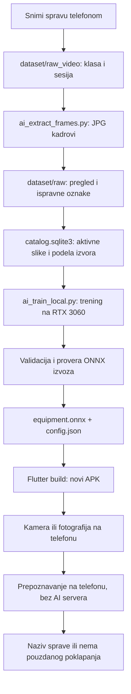

# AI prepoznavanje sprava — dokumentacija projekta

Stanje dokumentovano: **20. septembar 2026.** Putanje, parametri i rezultati provereni su u lokalnom projektu. Ovaj folder sadrži dokumentaciju; aplikacija, dataset i model ostaju u svojim postojećim folderima.

Napravljena je probna funkcionalnost koja na telefonu prepoznaje dve tvoje sprave preko kamere ili fotografije. Trening se obavlja na tvom računaru, a prepoznavanje u aplikaciji radi lokalno, bez AI API-ja, pretplate ili dodatnog naloga.

## Šta prvo da pročitaš

| Dokument | Šta objašnjava |
|---|---|
| [01 — Šta je urađeno i šta je korišćeno](01_URADJENO_I_TEHNOLOGIJE.md) | Implementaciju, biblioteke, model, rezultate i šta još nije završeno. |
| [02 — Slike, snimci i lokacije fajlova](02_PODACI_I_FOLDERI.md) | Gde je „baza slika“, pravila imenovanja, dodavanje snimaka/fotografija i backup. |
| [03 — Kako dalje da treniraš modele](03_TRENING_KORAK_PO_KORAK.md) | PowerShell komande od novih snimaka do novog APK-a, dodavanje sprava i `unknown` klase. |
| [04 — Ceo tok i ponašanje aplikacije](04_TOK_APLIKACIJE_I_OGRANICENJA.md) | Kako slika postaje naziv sprave, pragove, timeout i postojeća ograničenja. |
| [05 — Troškovi i održavanje](05_TROSKOVI_I_ODRZAVANJE.md) | Šta je besplatno, stvarne troškove, potrebne naloge i održavanje. |
| [06 — Lokalna SQLite baza](06_LOKALNA_BAZA.md) | Uvoz i pregled slika, duplikati, isključivanje primera, podela izvora i backup. |
| [07 — Roboflow datasetovi i licence](07_ROBOFLOW_DATASETOVI_I_LICENCE.md) | Provereni uslovi za FitFuel/GymBro, besplatno preuzimanje i priprema pre treninga. |
| [08 — Uvoz ZIP-ova i novi trening](08_UVOZ_I_TRENING_ROBOFLOW.md) | Novi katalog sa 11.915 slika, 29 opštih klasa, priprema i odvojeni kandidati modela. |
| [09 — Novi trening i roman chair](09_NOVI_TRENING_I_ROMAN_CHAIR.md) | Razlika 33/29 kategorija, pregled stvarnih primera i novi trening sa celim kadrom. |
| [10 — Novi datasetovi v3 i rezultat](10_NOVI_DATASETI_V3_I_REZULTAT.md) | Uvoz tri nova ZIP-a, mapa klasa, Roman Chair i zašto v3 kandidat nije pušten u aplikaciju. |
| [11 — V4 sva oprema i rezultat](11_V4_SVA_OPREMA_I_REZULTAT.md) | Kablovi, ploče, trake, nastavci i rekviziti kao klase; rezultat proširenog modela. |
| [12 — Ručni pregled i ispravka podataka](12_RUCNI_PREGLED_I_ISPRAVKA_PODATAKA.md) | Zašto je izgubljen veliki broj slika, rezultat prvih 100 ručno pregledanih primera i ispravka Roman Chair klase. |

Ako želiš odmah da dodaš snimke i pokreneš trening, pročitaj **02**, pa **03**.

Naknadno je napravljena lokalna SQLite baza `dataset/catalog.sqlite3`, sa svih 97 postojećih slika. Fotografije ostaju u folderima, baza čuva njihove podatke, a telefon koristi samo model. Za rad sa bazom pročitaj **06**.

Preuzeti Roboflow ZIP-ovi sada su obrađeni u **odvojenom** skupu `dataset/external/roboflow_v2_20260920`, sa zasebnim katalogom. Originalni dataset i model u aplikaciji nisu zamenjeni. Za novi, širi model čitaj **08**.

Najnoviji završen pokušaj je u **09**: EfficientNet je bolji po ukupnom prvom izboru, ali ne rešava korisničku roman-chair fotografiju i nije spreman za zamenu skenera. Baza ima **33 sačuvane kategorije, od kojih 29 učestvuje u treningu**; četiri su označene kao `exclude` zbog premalo podataka.

## Najvažnije lokacije

```text
C:\Users\veljk\Desktop\FitnesApp\
├── AI_machine_recognise\                  ova dokumentacija
├── dataset\
│   ├── catalog.sqlite3                     lokalni katalog slika i izvora
│   ├── raw_video\                         organizovani video-snimci
│   └── raw\                               izdvojene JPG slike za trening
└── fitness_plus\
    ├── tool\ai_catalog.py                 uvoz i upravljanje SQLite katalogom
    ├── tool\ai_train_local.py             lokalni trening
    ├── tool\ai_extract_frames.py          izvlačenje slika iz videa
    ├── tool\ai_predict.py                 provera fotografije na računaru
    ├── assets\ml\equipment_scan\          ONNX model + konfiguracija za aplikaciju
    ├── artifacts\equipment_scan\          izveštaji i pomoćni fajlovi
    ├── lib\features\equipment_scan\       Flutter funkcionalnost
    └── build\app\outputs\flutter-apk\app-debug.apk
```

## Ceo tok u jednoj slici



## Kako trenutno da probaš

Instalacioni fajl je [app-debug.apk](../fitness_plus/build/app/outputs/flutter-apk/app-debug.apk). Na početnom ekranu aplikacije pritisni ikonicu **Scan equipment** pored profila i dozvoli kameru. Možeš i da koristiš **Take a photo** ili **Choose a photo**.

Trenutne klase su:

- `converging_chest_press` — Converging chest press machine;
- `plate_loaded_seated_row` — Plate-loaded seated row machine.

Ovo je početni model sa četiri snimka iz jedne teretane. Nepoznata sprava još može biti pogrešno prihvaćena kao jedna od ove dve. Sledeći važan korak su stvarni negativni primeri i novi snimci poznatih sprava; više o tome u dokumentima 02 i 03.

Za ovu dokumentaciju nije ponovo pokretan trening, build niti kompletan test paket. Opisani su postojeće stanje i komande koje ti možeš sledeće da pokreneš.
